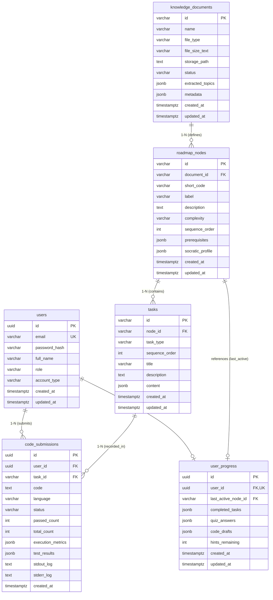

# TÀI LIỆU ĐẶC TẢ CƠ SỞ DỮ LIỆU TINH GỌN (LEAN DSA DATABASE SPECIFICATION)

**Dự án:** Nền tảng Hỗ trợ Học tập Thông minh OffByOne (AI CS Tutor)  
**Phiên bản:** 2.0 (Lean Model - Cấu trúc 6 Bảng trọng tâm môn Cấu trúc Dữ liệu & Giải thuật - DSA)  
**Hệ quản trị CSDL:** PostgreSQL / Supabase  
**Người cập nhật:** Team Lead & Frontend Lead  
**Ngày cập nhật:** 16/11/2026  

---

## 1. TỔNG QUAN KIẾN TRÚC & LÝ DO TINH GỌN

### 1.1. Bối cảnh thay đổi
Ở phiên bản ban đầu, hệ thống thiết kế theo hướng phân tán vi mô (Micro-normalization) với hơn 25-27 bảng liên kết chéo phức tạp (tách riêng câu hỏi, đáp án trắc nghiệm, từng test case, bảng chấm điểm, log AI chat, lịch sử phỏng vấn, hồ sơ cá nhân,...). Thiết kế này dẫn đến:
- Khó quản lý và khó mở rộng trong giai đoạn phát triển đầu (MVP).
- Gây nghẽn truy vấn khi cần JOIN qua 5-7 bảng chỉ để hiển thị 1 trang học tập.
- Dễ phát sinh lỗi không nhất quán dữ liệu và khó kiểm soát Row Level Security (RLS) trên Supabase.

### 1.2. Giải pháp: Kiến trúc Hybrid Relational + JSONB (6 Bảng Lean)
Hệ thống được tinh gọn triệt để xuống **đúng 6 bảng cốt lõi**, tận dụng sức mạnh lưu trữ tài liệu **JSONB** của PostgreSQL cho các cấu trúc dữ liệu phân nhánh linh hoạt (cây điều kiện tiên quyết, nội dung bài học, test cases, cấu hình Socratic AI và tiến độ học tập).

```
┌────────────────────────────────────────────────────────────────────────┐
│                        LEAN 6-TABLE ARCHITECTURE                       │
├────────────────────┬─────────────────────────────┬─────────────────────┤
│ 1. users           │ Tài khoản & Phân quyền      │ Auth & Identity     │
│ 2. knowledge_docs  │ Giáo trình & RAG Syllabus   │ Context Engine      │
│ 3. roadmap_nodes   │ 10 Kỹ năng Cốt lõi DSA      │ Learning Map        │
│ 4. tasks           │ 30 Đơn vị bài học (Lý thuyết, Trắc nghiệm, Code) │ Content Engine │
│ 5. user_progress   │ Tiến độ & Trạng thái làm bài│ User State          │
│ 6. code_submissions│ Lịch sử chấm code & Metrics │ Execution Audit     │
└────────────────────┴─────────────────────────────┴─────────────────────┘
```

---

## 2. SƠ ĐỒ THỰC THỂ QUAN HỆ (ERD - MERMAID)



---

## 3. ĐẶC TẢ CHI TIẾT 6 BẢNG DỮ LIỆU

### 3.1. Bảng `users` (Tài khoản người dùng)
* **Chức năng:** Quản lý thông tin danh tính, loại tài khoản và phân quyền người dùng trong hệ thống.
* **Số lượng bản ghi khởi tạo:** 3 tài khoản demo chuẩn (Student, Tutor, Admin).

| Tên trường (Column) | Kiểu dữ liệu | Ràng buộc (Constraints) | Ý nghĩa / Mô tả |
| :--- | :--- | :--- | :--- |
| `id` | `UUID` | `PRIMARY KEY, DEFAULT gen_random_uuid()` | Khóa chính định danh tài khoản. |
| `email` | `VARCHAR(255)` | `UNIQUE, NOT NULL` | Email dùng để đăng nhập. |
| `password_hash` | `VARCHAR(255)` | `NOT NULL` | Mật khẩu được băm (bcrypt / PBKDF2). |
| `full_name` | `VARCHAR(255)` | `NOT NULL` | Họ và tên hiển thị của người dùng. |
| `role` | `VARCHAR(50)` | `DEFAULT 'student'`, `CHECK (role IN ('student', 'tutor', 'admin'))` | Vai trò trong hệ thống. |
| `account_type` | `VARCHAR(50)` | `DEFAULT 'registered'`, `CHECK (account_type IN ('guest', 'registered', 'admin'))` | Loại tài khoản (khách trải nghiệm hoặc đã kích hoạt). |
| `created_at` | `TIMESTAMPTZ` | `DEFAULT NOW()` | Thời điểm tạo tài khoản. |
| `updated_at` | `TIMESTAMPTZ` | `DEFAULT NOW()` | Thời điểm cập nhật thông tin gần nhất. |

---

### 3.2. Bảng `knowledge_documents` (Tài liệu học tập & RAG)
* **Chức năng:** Lưu trữ thông tin tài liệu giáo trình chuẩn (ví dụ: CS101 DSA Syllabus của HCMUS) dùng để xây dựng lộ trình học tập và làm ngữ cảnh cho AI Socratic Tutor.

| Tên trường | Kiểu dữ liệu | Ràng buộc | Ý nghĩa / Mô tả |
| :--- | :--- | :--- | :--- |
| `id` | `VARCHAR(100)` | `PRIMARY KEY` | Khóa chính dạng định danh ngắn gọn (vd: `'doc-dsa-syllabus'`). |
| `name` | `VARCHAR(255)` | `NOT NULL` | Tên tài liệu hiển thị (vd: `'CS101_DSA_Syllabus_HCMUS.pdf'`). |
| `file_type` | `VARCHAR(50)` | `NOT NULL` | Định dạng file (`'pdf'`, `'docx'`). |
| `file_size_text` | `VARCHAR(50)` | `NULLABLE` | Kích thước hiển thị dạng text (vd: `'2.4 MB'`). |
| `storage_path` | `TEXT` | `NULLABLE` | Đường dẫn lưu trữ file trên Supabase Storage / Cloud. |
| `status` | `VARCHAR(50)` | `DEFAULT 'indexed'`, `CHECK (status IN ('uploaded', 'indexing', 'indexed', 'error'))` | Trạng thái trích xuất vector / mục lục của tài liệu. |
| `extracted_topics` | `JSONB` | `DEFAULT '[]'::jsonb` | Mảng danh sách các chủ đề chính được trích xuất. |
| `metadata` | `JSONB` | `DEFAULT '{}'::jsonb` | Siêu dữ liệu mở rộng (số trang, đơn vị đào tạo, học kỳ áp dụng). |
| `created_at` | `TIMESTAMPTZ` | `DEFAULT NOW()` | Ngày tải lên. |
| `updated_at` | `TIMESTAMPTZ` | `DEFAULT NOW()` | Ngày cập nhật. |

---

### 3.3. Bảng `roadmap_nodes` (10 Kỹ năng Cốt lõi DSA)
* **Chức năng:** Đại diện cho 10 chủ đề/nút kỹ năng trên Cây lộ trình DSA (từ Arrays, Linked List cho tới Dynamic Programming và Graph Algorithms).

| Tên trường | Kiểu dữ liệu | Ràng buộc | Ý nghĩa / Mô tả |
| :--- | :--- | :--- | :--- |
| `id` | `VARCHAR(100)` | `PRIMARY KEY` | Khóa chính dạng slug (vd: `'arrays-and-strings'`, `'avl-tree'`). |
| `document_id` | `VARCHAR(100)` | `REFERENCES knowledge_documents(id) ON DELETE SET NULL` | Khóa ngoại liên kết tài liệu nguồn. |
| `short_code` | `VARCHAR(20)` | `NOT NULL` | Mã số thứ tự hiển thị (vd: `'01'`, `'02'`, ..., `'10'`). |
| `label` | `VARCHAR(255)` | `NOT NULL` | Tên kỹ năng (vd: `'AVL Tree & Balanced BST'`). |
| `description` | `TEXT` | `NULLABLE` | Tóm tắt kiến thức của nút kỹ năng. |
| `complexity` | `VARCHAR(100)` | `NULLABLE` | Độ phức tạp thời gian/không gian tiêu biểu (vd: `'O(log N)'`). |
| `sequence_order`| `INT` | `NOT NULL` | Thứ tự xuất hiện trong lộ trình (1 $\to$ 10). |
| `prerequisites` | `JSONB` | `DEFAULT '[]'::jsonb` | Mảng chứa các `id` của node tiên quyết bắt buộc phải mở khóa trước. |
| `socratic_profile`| `JSONB` | `DEFAULT '{}'::jsonb` | Hồ sơ sư phạm dành cho AI (Invariants, Slide References, Gợi ý trọng tâm). |
| `created_at` | `TIMESTAMPTZ` | `DEFAULT NOW()` | Thời gian tạo. |
| `updated_at` | `TIMESTAMPTZ` | `DEFAULT NOW()` | Thời gian cập nhật. |

#### Cấu trúc JSONB trường `socratic_profile`:
```json
{
  "keyInvariants": [
    "Height balance property: |H(left) - H(right)| <= 1",
    "BST property: All left keys < Root key < All right keys"
  ],
  "commonMisconceptions": [
    "Confusing Left-Right double rotation with two separate single rotations",
    "Forgetting to update heights after pointer manipulation"
  ],
  "primarySlideReference": "Lecture 08 - Balanced Trees, Slide 24"
}
```

---

### 3.4. Bảng `tasks` (30 Đơn vị bài học & Thực hành)
* **Chức năng:** Mỗi `roadmap_node` sở hữu đúng 3 tasks (`theory`: Lý thuyết, `quiz`: Trắc nghiệm củng cố, `coding`: Bài tập lập trình thực hành). Tổng cộng 10 nodes $\times$ 3 = 30 tasks.

| Tên trường | Kiểu dữ liệu | Ràng buộc | Ý nghĩa / Mô tả |
| :--- | :--- | :--- | :--- |
| `id` | `VARCHAR(100)` | `PRIMARY KEY` | Khóa chính (vd: `'avl-tree-task-1'`, `'avl-tree-task-3'`). |
| `node_id` | `VARCHAR(100)` | `REFERENCES roadmap_nodes(id) ON DELETE CASCADE, NOT NULL` | Khóa ngoại trỏ về node sở hữu. |
| `task_type` | `VARCHAR(50)` | `NOT NULL, CHECK (task_type IN ('theory', 'quiz', 'coding'))` | Loại bài tập. |
| `sequence_order`| `INT` | `NOT NULL` | Thứ tự trong node (1: Theory, 2: Quiz, 3: Coding). |
| `title` | `VARCHAR(255)` | `NOT NULL` | Tiêu đề bài học. |
| `description` | `TEXT` | `NULLABLE` | Mô tả ngắn gọn yêu cầu. |
| `content` | `JSONB` | `NOT NULL, DEFAULT '{}'::jsonb` | Toàn bộ payload chi tiết của bài học (Markdown lý thuyết / Bộ câu hỏi trắc nghiệm / Template code C++ & Test Cases). |
| `created_at` | `TIMESTAMPTZ` | `DEFAULT NOW()` | Thời gian tạo. |
| `updated_at` | `TIMESTAMPTZ` | `DEFAULT NOW()` | Thời gian cập nhật. |

#### Minh họa `content` theo từng `task_type`:

* **Khi `task_type == 'theory'`:**
  ```json
  {
    "markdown": "# AVL Tree & Balanced BST\n\n## 1. Motivation\nKhi BST thông thường bị suy biến thành danh sách liên kết...",
    "keyTakeaways": ["Balance factor", "Rotations: LL, RR, LR, RL"],
    "estimatedReadMinutes": 7
  }
  ```

* **Khi `task_type == 'quiz'`:**
  ```json
  {
    "question": "Sau khi chèn một phần tử vào cây con bên trái của con bên trái khiến cây mất cân bằng, ta cần thực hiện phép xoay nào?",
    "options": [
      { "id": "A", "text": "Phép xoay đơn sang phải (Right Rotation)", "isCorrect": true },
      { "id": "B", "text": "Phép xoay đơn sang trái (Left Rotation)", "isCorrect": false },
      { "id": "C", "text": "Phép xoay kép Trái - Phải (LR Rotation)", "isCorrect": false },
      { "id": "D", "text": "Không cần xoay", "isCorrect": false }
    ],
    "explanation": "Trường hợp Left-Left (LL) mất cân bằng do cây bên trái quá nặng, giải pháp là xoay đơn sang phải quanh nút gốc mất cân bằng."
  }
  ```

* **Khi `task_type == 'coding'`:**
  ```json
  {
    "language": "C++",
    "starterCode": "#include <iostream>\nusing namespace std;\n\nstruct Node {\n    int key, height;\n    Node *left, *right;\n};\n\nNode* rotateRight(Node* y) {\n    // TODO: Cài đặt hàm xoay phải tại đây\n    return nullptr;\n}\n",
    "solutionCode": "...",
    "testCases": [
      { "id": 1, "label": "Test Case #1", "input": "...", "expectedOutput": "...", "isPublic": true },
      { "id": 2, "label": "Test Case #2 (Hidden)", "input": "...", "expectedOutput": "...", "isPublic": false }
    ]
  }
  ```

---

### 3.5. Bảng `user_progress` (Tiến độ học viên)
* **Chức năng:** Lưu vết trạng thái học tập của từng học viên theo thời gian thực (các bài đã hoàn thành, đáp án trắc nghiệm đã chọn, code nháp đang gõ dở, số lượt gợi ý AI còn lại).

| Tên trường | Kiểu dữ liệu | Ràng buộc | Ý nghĩa / Mô tả |
| :--- | :--- | :--- | :--- |
| `id` | `UUID` | `PRIMARY KEY, DEFAULT gen_random_uuid()` | Khóa chính định danh dòng tiến độ. |
| `user_id` | `UUID` | `REFERENCES users(id) ON DELETE CASCADE, UNIQUE, NOT NULL` | Khóa ngoại 1-1 với tài khoản người dùng. |
| `last_active_node_id`| `VARCHAR(100)` | `REFERENCES roadmap_nodes(id) ON DELETE SET NULL` | Nút kỹ năng người dùng học gần nhất. |
| `completed_tasks` | `JSONB` | `DEFAULT '{}'::jsonb` | Bản đồ lưu trạng thái bài học đã hoàn thành: `{"avl-tree-task-1": true}`. |
| `quiz_answers` | `JSONB` | `DEFAULT '{}'::jsonb` | Bản đồ lưu đáp án trắc nghiệm học viên đã chọn: `{"avl-tree-task-2": "A"}`. |
| `code_drafts` | `JSONB` | `DEFAULT '{}'::jsonb` | Bản nháp code đang gõ dở theo từng task để phục hồi khi mở lại trang. |
| `hints_remaining` | `INT` | `DEFAULT 3` | Số lượng gợi ý Socratic AI còn lại trong ngày của sinh viên. |
| `created_at` | `TIMESTAMPTZ` | `DEFAULT NOW()` | Thời điểm khởi tạo. |
| `updated_at` | `TIMESTAMPTZ` | `DEFAULT NOW()` | Thời điểm cập nhật trạng thái gần nhất. |

---

### 3.6. Bảng `code_submissions` (Lịch sử nộp bài & Đánh giá)
* **Chức năng:** Lưu trữ toàn bộ lịch sử biên dịch và chấm code của sinh viên khi bấm nút "Run Code" hoặc "Submit". Cung cấp dữ liệu kiểm toán và phân tích hiệu năng thuật toán.

| Tên trường | Kiểu dữ liệu | Ràng buộc | Ý nghĩa / Mô tả |
| :--- | :--- | :--- | :--- |
| `id` | `UUID` | `PRIMARY KEY, DEFAULT gen_random_uuid()` | Khóa chính định danh lần nộp bài. |
| `user_id` | `UUID` | `REFERENCES users(id) ON DELETE CASCADE, NOT NULL` | Người nộp bài. |
| `task_id` | `VARCHAR(100)` | `REFERENCES tasks(id) ON DELETE CASCADE, NOT NULL` | Bài tập được nộp. |
| `code` | `TEXT` | `NOT NULL` | Toàn văn mã nguồn sinh viên đã nộp. |
| `language` | `VARCHAR(50)` | `DEFAULT 'C++'` | Ngôn ngữ lập trình (`'C++'`, `'Python'`, `'Java'`). |
| `status` | `VARCHAR(50)` | `CHECK (status IN ('success', 'failed', 'compilation_error', 'runtime_error', 'timeout'))` | Kết quả tổng thể của lần nộp. |
| `passed_count` | `INT` | `DEFAULT 0` | Số lượng test cases vượt qua thành công. |
| `total_count` | `INT` | `DEFAULT 0` | Tổng số test cases được chạy chấm. |
| `execution_metrics` | `JSONB` | `DEFAULT '{}'::jsonb` | Chỉ số thực thi chi tiết (thời gian chạy `runtimeMs`, dung lượng RAM `memoryMb`). |
| `test_results` | `JSONB` | `DEFAULT '[]'::jsonb` | Danh sách kết quả chi tiết từng test case (stdout, actual vs expected). |
| `stdout_log` | `TEXT` | `NULLABLE` | Nhật ký đầu ra chuẩn của chương trình. |
| `stderr_log` | `TEXT` | `NULLABLE` | Thông báo lỗi biên dịch hoặc lỗi runtime (nếu có). |
| `created_at` | `TIMESTAMPTZ` | `DEFAULT NOW()` | Thời điểm nộp bài. |

---

## 4. BẢO MẬT & ROW LEVEL SECURITY (RLS)

Trong môi trường hoàn chỉnh tích hợp với Backend FastAPI:
1. **Kiến trúc bảo mật tiêu chuẩn (Zero Client Direct Trust):**
   - Frontend không truy vấn trực tiếp vào database Supabase mà chỉ tương tác thông qua các API endpoints an toàn tại `http://localhost:8000/api/...`.
   - Backend sử dụng Service Role Key (hoặc kết nối qua Postgres Pool / SQLModel) với quyền quản trị để đọc và ghi dữ liệu có kiểm duyệt logic.
2. **Chính sách lọc dữ liệu nhạy cảm trên API:**
   - **Quiz:** API `GET /api/tasks/{task_id}` bắt buộc lọc bỏ thuộc tính `isCorrect` trong JSON options trước khi trả về Frontend. Việc chấm điểm do API `POST /api/quiz/evaluate` xử lý.
   - **Coding:** Giấu các Hidden Test Cases ở API công khai; chỉ chấm đầy đủ khi gọi `POST /api/code/submit`.
3. **Cấu hình trên Supabase SQL Editor:**
   - Để tránh lỗi chặn `42501 (violates row-level security policy)` trong giai đoạn kiểm thử hoặc khi frontend gọi tạm trực tiếp, RLS được tạm thời tắt (`DISABLE ROW LEVEL SECURITY`) hoặc cấp quyền đọc/ghi công khai cho các vai trò (`anon`, `authenticated`, `service_role`).

---

## 5. SCRIPT KHỞI TẠO CSDL TOÀN DIỆN (FULL SQL DDL SCRIPT)

Dưới đây là toàn bộ mã nguồn SQL có thể copy và chạy trực tiếp trên **Supabase SQL Editor** để khởi tạo mới toàn bộ 6 bảng và các chỉ mục (Indexes) tối ưu truy vấn:

```sql
-- =========================================================================
-- OFFBYONE LEAN DSA DATABASE DDL SCRIPT (6 TABLES)
-- =========================================================================

-- 1. BẢNG USERS
CREATE TABLE IF NOT EXISTS public.users (
    id UUID PRIMARY KEY DEFAULT gen_random_uuid(),
    email VARCHAR(255) UNIQUE NOT NULL,
    password_hash VARCHAR(255) NOT NULL,
    full_name VARCHAR(255) NOT NULL,
    role VARCHAR(50) DEFAULT 'student' CHECK (role IN ('student', 'tutor', 'admin')),
    account_type VARCHAR(50) DEFAULT 'registered' CHECK (account_type IN ('guest', 'registered', 'admin')),
    created_at TIMESTAMPTZ DEFAULT NOW(),
    updated_at TIMESTAMPTZ DEFAULT NOW()
);

-- 2. BẢNG KNOWLEDGE_DOCUMENTS
CREATE TABLE IF NOT EXISTS public.knowledge_documents (
    id VARCHAR(100) PRIMARY KEY,
    name VARCHAR(255) NOT NULL,
    file_type VARCHAR(50) NOT NULL,
    file_size_text VARCHAR(50),
    storage_path TEXT,
    status VARCHAR(50) DEFAULT 'indexed' CHECK (status IN ('uploaded', 'indexing', 'indexed', 'error')),
    extracted_topics JSONB DEFAULT '[]'::jsonb,
    metadata JSONB DEFAULT '{}'::jsonb,
    created_at TIMESTAMPTZ DEFAULT NOW(),
    updated_at TIMESTAMPTZ DEFAULT NOW()
);

-- 3. BẢNG ROADMAP_NODES
CREATE TABLE IF NOT EXISTS public.roadmap_nodes (
    id VARCHAR(100) PRIMARY KEY,
    document_id VARCHAR(100) REFERENCES public.knowledge_documents(id) ON DELETE SET NULL,
    short_code VARCHAR(20) NOT NULL,
    label VARCHAR(255) NOT NULL,
    description TEXT,
    complexity VARCHAR(100),
    sequence_order INT NOT NULL,
    prerequisites JSONB DEFAULT '[]'::jsonb,
    socratic_profile JSONB DEFAULT '{}'::jsonb,
    created_at TIMESTAMPTZ DEFAULT NOW(),
    updated_at TIMESTAMPTZ DEFAULT NOW()
);

-- 4. BẢNG TASKS
CREATE TABLE IF NOT EXISTS public.tasks (
    id VARCHAR(100) PRIMARY KEY,
    node_id VARCHAR(100) NOT NULL REFERENCES public.roadmap_nodes(id) ON DELETE CASCADE,
    task_type VARCHAR(50) NOT NULL CHECK (task_type IN ('theory', 'quiz', 'coding')),
    sequence_order INT NOT NULL,
    title VARCHAR(255) NOT NULL,
    description TEXT,
    content JSONB NOT NULL DEFAULT '{}'::jsonb,
    created_at TIMESTAMPTZ DEFAULT NOW(),
    updated_at TIMESTAMPTZ DEFAULT NOW()
);

-- 5. BẢNG USER_PROGRESS
CREATE TABLE IF NOT EXISTS public.user_progress (
    id UUID PRIMARY KEY DEFAULT gen_random_uuid(),
    user_id UUID NOT NULL REFERENCES public.users(id) ON DELETE CASCADE UNIQUE,
    last_active_node_id VARCHAR(100) REFERENCES public.roadmap_nodes(id) ON DELETE SET NULL,
    completed_tasks JSONB DEFAULT '{}'::jsonb,
    quiz_answers JSONB DEFAULT '{}'::jsonb,
    code_drafts JSONB DEFAULT '{}'::jsonb,
    hints_remaining INT DEFAULT 3,
    created_at TIMESTAMPTZ DEFAULT NOW(),
    updated_at TIMESTAMPTZ DEFAULT NOW()
);

-- 6. BẢNG CODE_SUBMISSIONS
CREATE TABLE IF NOT EXISTS public.code_submissions (
    id UUID PRIMARY KEY DEFAULT gen_random_uuid(),
    user_id UUID NOT NULL REFERENCES public.users(id) ON DELETE CASCADE,
    task_id VARCHAR(100) NOT NULL REFERENCES public.tasks(id) ON DELETE CASCADE,
    code TEXT NOT NULL,
    language VARCHAR(50) DEFAULT 'C++',
    status VARCHAR(50) NOT NULL CHECK (status IN ('success', 'failed', 'compilation_error', 'runtime_error', 'timeout')),
    passed_count INT DEFAULT 0,
    total_count INT DEFAULT 0,
    execution_metrics JSONB DEFAULT '{}'::jsonb,
    test_results JSONB DEFAULT '[]'::jsonb,
    stdout_log TEXT,
    stderr_log TEXT,
    created_at TIMESTAMPTZ DEFAULT NOW()
);

-- TẠO CHỈ MỤC TỐI ƯU TRUY VẤN (INDEXES)
CREATE INDEX IF NOT EXISTS idx_users_email ON public.users(email);
CREATE INDEX IF NOT EXISTS idx_roadmap_nodes_seq ON public.roadmap_nodes(sequence_order);
CREATE INDEX IF NOT EXISTS idx_tasks_node_id ON public.tasks(node_id);
CREATE INDEX IF NOT EXISTS idx_tasks_type ON public.tasks(task_type);
CREATE INDEX IF NOT EXISTS idx_progress_user_id ON public.user_progress(user_id);
CREATE INDEX IF NOT EXISTS idx_submissions_user_task ON public.code_submissions(user_id, task_id);

-- TẮT RLS TRÁNH CHẶN TRUY VẤN DEV & TEST
ALTER TABLE public.users DISABLE ROW LEVEL SECURITY;
ALTER TABLE public.knowledge_documents DISABLE ROW LEVEL SECURITY;
ALTER TABLE public.roadmap_nodes DISABLE ROW LEVEL SECURITY;
ALTER TABLE public.tasks DISABLE ROW LEVEL SECURITY;
ALTER TABLE public.user_progress DISABLE ROW LEVEL SECURITY;
ALTER TABLE public.code_submissions DISABLE ROW LEVEL SECURITY;

-- CẤP QUYỀN TRUY CẬP ĐẦY ĐỦ CHO CÁC ROLE
GRANT ALL ON TABLE public.users TO anon, authenticated, service_role;
GRANT ALL ON TABLE public.knowledge_documents TO anon, authenticated, service_role;
GRANT ALL ON TABLE public.roadmap_nodes TO anon, authenticated, service_role;
GRANT ALL ON TABLE public.tasks TO anon, authenticated, service_role;
GRANT ALL ON TABLE public.user_progress TO anon, authenticated, service_role;
GRANT ALL ON TABLE public.code_submissions TO anon, authenticated, service_role;
```

---

## 6. DANH SÁCH 10 NÚT KỸ NĂNG DSA TIÊU CHUẨN ĐÃ NẠP

| Mã nút (ID) | Short Code | Tên kỹ năng (Label) | Độ phức tạp | Tiên quyết (Prerequisites) |
| :--- | :--- | :--- | :--- | :--- |
| `arrays-and-strings` | `01` | Arrays & String Primitives | O(1) access, O(N) search | `[]` (Khởi đầu) |
| `linked-lists` | `02` | Singly & Doubly Linked Lists | O(1) insert/delete at head | `["arrays-and-strings"]` |
| `stacks-and-queues` | `03` | Stacks, Queues & Monotonic Deque | O(1) push/pop, O(N) span | `["linked-lists"]` |
| `recursion-and-backtracking` | `04` | Recursion & Backtracking Invariants | O(2^N) / O(N!) search space | `["stacks-and-queues"]` |
| `binary-trees` | `05` | Binary Trees & Traversal Orders | O(N) traversal | `["recursion-and-backtracking"]` |
| `binary-search-tree` | `06` | Binary Search Trees & BST Invariant | O(log N) avg, O(N) worst | `["binary-trees"]` |
| `priority-queues-heap` | `07` | Binary Heaps & Priority Queues | O(log N) push/pop, O(1) peek | `["binary-trees"]` |
| `avl-tree` | `08` | AVL Tree & Balanced BST | O(log N) strict worst-case | `["binary-search-tree"]` |
| `graph-traversal` | `09` | Graph Fundamentals: BFS & DFS | O(V + E) time, O(V) space | `["stacks-and-queues"]` |
| `dynamic-programming` | `10` | Dynamic Programming: Memoization & Tabulation | O(N) to O(N^2) polynomial | `["recursion-and-backtracking"]` |
