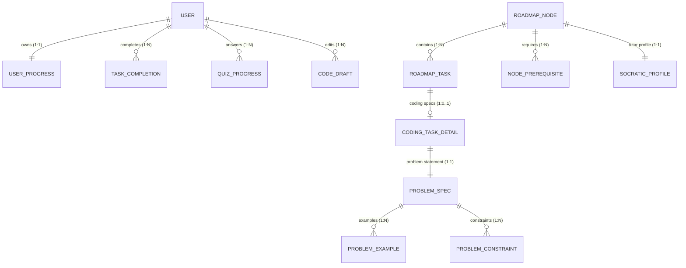

# BÁO CÁO KHẢO SÁT VÀ ĐÁNH GIÁ CẤU TRÚC DỮ LIỆU DỰ ÁN OFFBYONE
**Mã tài liệu:** `DOCS-AUDIT-OFFBYONE-2026-V1`  
**Vai trò thực hiện:** Senior Backend Architect & Database Analyst  
**Ngày lập báo cáo:** 03/11/2026  
**Trạng thái kiểm tra:** Hoàn thành khảo sát toàn diện (100% Repository Audit)

---

## MỤC LỤC
1. [TỔNG QUAN KIẾN TRÚC DỮ LIỆU HIỆN TẠI](#1-tổng-quan-kiến-trúc-dữ-liệu-hiện-tại)
2. [DANH SÁCH CÁC THỰC THỂ DỮ LIỆU (ENTITIES)](#2-danh-sách-các-thực-thể-dữ-liệu-entities)
3. [TỪ ĐIỂN DỮ LIỆU CHI TIẾT (DATA DICTIONARY)](#3-từ-điển-dữ-liệu-chi-tiết-data-dictionary)
4. [QUAN HỆ GIỮA CÁC THỰC THỂ (RELATIONSHIPS & CARDINALITY)](#4-quan-hệ-giữa-các-thực-thể-relationships--cardinality)
5. [KHẢO SÁT CHUYÊN SÂU CẤU TRÚC BÀI TẬP LẬP TRÌNH (CODING TASK)](#5-khảo-sát-chuyên-sâu-cấu-trúc-bài-tập-lập-trình-coding-task)
6. [CƠ CHẾ LƯU TRỮ VÀ ĐỘ BỀN DỮ LIỆU (DATA PERSISTENCE AUDIT)](#6-cơ-chế-lưu-trữ-và-độ-bền-dữ-liệu-data-persistence-audit)
7. [API VÀ LUỒNG TRAO ĐỔI DỮ LIỆU](#7-api-và-luồng-trao-đổi-dữ-liệu)
8. [SƠ ĐỒ THỰC THỂ LIÊN KẾT (ERD)](#8-sơ-đồ-thực-thể-liên-kết-erd)
9. [ĐÁNH GIÁ MỨC ĐỘ HOÀN THIỆN VÀ KHUYẾN NGHỊ KIẾN TRÚC](#9-đánh-giá-mức-độ-hoàn-thiện-và-khuyến-nghị-kiến-trúc)

---

## 1. TỔNG QUAN KIẾN TRÚC DỮ LIỆU HIỆN TẠI

Qua kiểm tra toàn bộ mã nguồn của dự án **OffByOne** (bao gồm thư mục `api/` và thư mục `web/`), hiện trạng kiến trúc dữ liệu của hệ thống được ghi nhận chính xác như sau:

> [!IMPORTANT]
> **KẾT QUẢ AUDIT DATABASE THỰC TẾ:**
> - Dự án **CHƯA CÓ cơ sở dữ liệu quan hệ (RDBMS) hay NoSQL thực tế**.
> - Không có bất kỳ file cấu hình ORM (SQLAlchemy, Prisma, Drizzle, TypeORM), không có file schema SQL (`.sql`) và không có migration files (Alembic).
> - Thư mục Backend `api/` chỉ chứa một file PoC đơn giản (`api/main.py`) sử dụng FastAPI với 2 endpoint thử nghiệm, chưa kết nối cơ sở dữ liệu.
> - **Cơ chế lưu trữ hiện tại là Client-Side Persistence**: Dữ liệu người dùng được lưu trữ cục bộ trên trình duyệt thông qua `window.localStorage` (đối với tài khoản sinh viên đã đăng ký) và `window.sessionStorage` (đối với tài khoản Khách).
> - Cấu trúc dữ liệu về đề cương, đồ thị cây kỹ năng (Roadmap DAG), bài tập lý thuyết, câu hỏi trắc nghiệm, bài tập code và trợ giảng Socratic AI đang được cung cấp thông qua **Mock Data Engine và Client-Side Services**.

```
┌─────────────────────────────────────────────────────────────────────────────┐
│                       OFFBYONE RUNTIME DATA TOPOLOGY                        │
├─────────────────────────────────────────────────────────────────────────────┤
│                                                                             │
│   ┌─────────────────────────────────────────────────────────────────────┐   │
│   │                        CLIENT BROWSER (Next.js)                     │   │
│   │                                                                     │   │
│   │  [React State / Context]  ◄───►  [Service Layer: auth / progress]   │   │
│   │           ▲                                    ▲                    │   │
│   │           │                                    │                    │   │
│   │           ▼                                    ▼                    │   │
│   │  [Monaco Code Editor]             [Browser Local/SessionStorage]    │   │
│   │  Single-file code buffer           - algopath_auth_session          │   │
│   │                                    - algopath_registered_users      │   │
│   │                                    - algopath_progress_v2_<userId>  │   │
│   └─────────────────────────────────────────────────────────────────────┘   │
│                                      │                                      │
│                                      │ (Conditional fetch if API_URL exists)│
│                                      ▼                                      │
│   ┌─────────────────────────────────────────────────────────────────────┐   │
│   │                       BACKEND (FastAPI - api/main.py)               │   │
│   │                                                                     │   │
│   │   - GET  /              (Healthcheck)                               │   │
│   │   - POST /api/evaluate  (Mock LangChain/Gemini Stub)                │   │
│   │   * DATABASE: None (0 tables, 0 migrations, 0 persistence)          │   │
│   └─────────────────────────────────────────────────────────────────────┘   │
│                                                                             │
└─────────────────────────────────────────────────────────────────────────────┘
```

---

## 2. DANH SÁCH CÁC THỰC THỂ DỮ LIỆU (ENTITIES)

Hệ thống đang định nghĩa và vận hành các nhóm thực thể logic sau trong mã nguồn:

### Nhóm A: User và Authentication
1. **`User` (Canonical Public User)**: Thực thể người dùng đã qua xác thực, chia sẻ toàn ứng dụng.
2. **`RegisteredUserRecord`**: Bản ghi tài khoản đã đăng ký kèm mã băm mật khẩu.
3. **`DemoUser`**: Dữ liệu tài khoản mẫu được định nghĩa sẵn cho môi trường thử nghiệm.
4. **`AuthSession`**: Phiên làm việc của người dùng hiện tại trong trình duyệt.

### Nhóm B: Learning Materials & Knowledge Base
5. **`KnowledgeBaseDoc`**: Metadata của tài liệu đề cương môn học (Syllabus PDF) được RAG phân tích.

### Nhóm C: Learning Roadmap (Đồ thị kỹ năng DAG)
6. **`LearningRoadmap`**: Gói dữ liệu tổng thể của cây kỹ năng bao gồm tiến độ tổng và danh sách node.
7. **`RoadmapNode`**: Một đỉnh (chủ đề kiến thức) trên đồ thị cây kỹ năng.
8. **`NodePrerequisite`**: Mối quan hệ phụ thuộc tiên quyết giữa các node.

### Nhóm D: Learning Tasks (Nội dung học tập)
9. **`RoadmapTask`**: Bài tập học tập gắn với một Node (Theory, Quiz, hoặc Coding).
10. **`TheoryContent`**: Nội dung chi tiết của bài học lý thuyết.
11. **`TheoryCard`**: Các thẻ kiến thức cô đọng trong bài lý thuyết.
12. **`QuizContent`**: Đề bài trắc nghiệm và cấu hình chấm điểm.
13. **`QuizOption`**: Các lựa chọn đáp án (A, B, C, D) của câu hỏi trắc nghiệm.
14. **`CodingTaskDetail`**: Cấu hình và mã nguồn ban đầu của bài tập lập trình.
15. **`ProblemSpec`**: Bản đặc tả chi tiết của bài toán lập trình (Problem Description).
16. **`ProblemExample`**: Các ví dụ mẫu (Input, Output, Giải thích).
17. **`ProblemConstraint`**: Các ràng buộc giới hạn bài toán.

### Nhóm E: Student Workspace & Progress
18. **`UserProgressData`**: Bản ghi tiến độ tổng thể của một người dùng.
19. **`TaskCompletion`**: Trạng thái hoàn thành của từng bài tập.
20. **`QuizProgressItem`**: Lựa chọn trắc nghiệm và trạng thái nộp bài của sinh viên.
21. **`CodeProgressItem` (Code Draft)**: Bản nháp mã nguồn đang viết dở trong Monaco Editor.
22. **`HintProgressItem`**: Số lượt gợi ý Socratic AI còn lại của sinh viên cho bài tập.

### Nhóm F: Code Execution & Socratic AI Tutor
23. **`ExecutionResult`**: Kết quả thực thi code (Run Code hoặc Submit) từ Execution Service.
24. **`TestCaseResult`**: Kết quả đánh giá trên từng test case riêng lẻ.
25. **`ComplexityAnalysis`**: Đánh giá độ phức tạp thuật toán và ghi chú tối ưu.
26. **`SocraticProfile`**: Hồ sơ trợ giảng thông minh gắn với chủ đề học tập.
27. **`SocraticTier`**: Các tầng gợi ý hỗ trợ tư duy tăng dần (Scaffolded hints).
28. **`SlideCitation`**: Trích dẫn nguồn tài liệu bài giảng / slide giáo trình liên quan.
29. **`DryRunTable`**: Bảng dữ liệu truy vết từng bước chạy của con trỏ (Dry-run trace).

---

## 3. TỪ ĐIỂN DỮ LIỆU CHI TIẾT (DATA DICTIONARY)

Dưới đây là bảng thống kê toàn bộ các trường dữ liệu thực tế được trích xuất từ source code, kèm vị trí file chính xác làm căn cứ.

### 3.1. Thực thể `User` (Public User Session)
- **Vị trí định nghĩa:** [`web/services/authService.js:33-42`](file:///d:/HCMUS_Subject/CT/AI_CS_Tutor/web/services/authService.js#L33-L42)
- **Nơi lưu trữ:** `window.sessionStorage.getItem("algopath_auth_session")`

| Tên trường (Field Name) | Kiểu dữ liệu | Bắt buộc | PK | FK | Giá trị mặc định | Mô tả |
| :--- | :--- | :---: | :---: | :---: | :--- | :--- |
| `id` | `string` | Có | PK | Không | Sinh tự động | Mã định danh duy nhất (vd: `user-demo-student-01` hoặc `guest-<uuid>`) |
| `fullName` | `string` | Có | Không | Không | Không có | Họ và tên hiển thị của sinh viên |
| `email` | `string` | Có | Không | Không | Không có | Địa chỉ email đăng nhập |
| `role` | `"student" \| "educator" \| "admin"` | Có | Không | Không | `"student"` | Vai trò của người dùng trong hệ thống |
| `accountType` | `"registered" \| "guest"` | Có | Không | Không | `"registered"` | Phân loại tài khoản đăng ký hay khách dùng thử |

### 3.2. Thực thể `RegisteredUserRecord` (User Storage Model)
- **Vị trí định nghĩa:** [`web/services/authService.js:87-94`](file:///d:/HCMUS_Subject/CT/AI_CS_Tutor/web/services/authService.js#L87-L94)
- **Nơi lưu trữ:** `window.localStorage.getItem("algopath_registered_users")`

| Tên trường (Field Name) | Kiểu dữ liệu | Bắt buộc | PK | FK | Giá trị mặc định | Mô tả |
| :--- | :--- | :---: | :---: | :---: | :--- | :--- |
| `id` | `string` | Có | PK | Không | Sinh tự động | Mã người dùng duy nhất |
| `email` | `string` | Có | Không | Không | Không có | Email duy nhất (dùng để tra cứu khi đăng nhập) |
| `fullName` | `string` | Có | Không | Không | Không có | Họ tên sinh viên |
| `role` | `string` | Có | Không | Không | `"student"` | Vai trò người dùng |
| `accountType` | `string` | Có | Không | Không | `"registered"` | Luôn là `"registered"` |
| `passwordDigest` | `string` | Có | Không | Không | Không có | Chuỗi mã băm một chiều (DJB2 salt digest), không lưu mật khẩu gốc |

### 3.3. Thực thể `KnowledgeBaseDoc` (Syllabus Metadata)
- **Vị trí định nghĩa:** [`web/mocks/roadmapData.js:6-13`](file:///d:/HCMUS_Subject/CT/AI_CS_Tutor/web/mocks/roadmapData.js#L6-L13)
- **Nơi lưu trữ:** Mock Data / Thuộc tính trong `UserProgressData`

| Tên trường (Field Name) | Kiểu dữ liệu | Bắt buộc | PK | FK | Giá trị mặc định | Mô tả |
| :--- | :--- | :---: | :---: | :---: | :--- | :--- |
| `id` | `string` | Có | PK | Không | `"doc-cs101-hcmus"` | Mã định danh tài liệu đề cương |
| `name` | `string` | Có | Không | Không | `"CS101_DSA_Syllabus_HCMUS.pdf"` | Tên file PDF đề cương |
| `size` | `string` | Có | Không | Không | `"2.4 MB"` | Dung lượng file |
| `chunks` | `number` | Có | Không | Không | `48` | Số lượng đoạn văn bản đã băm vector cho RAG |
| `status` | `"indexed" \| "processing" \| "error"` | Có | Không | Không | `"indexed"` | Trạng thái lập chỉ mục RAG |
| `indexedAt` | `string (ISO 8601)` | Có | Không | Không | Timestamp | Thời điểm hoàn tất lập chỉ mục |

### 3.4. Thực thể `RoadmapNode` (Đỉnh cây kỹ năng)
- **Vị trí định nghĩa:** [`web/mocks/roadmapData.js:20-430`](file:///d:/HCMUS_Subject/CT/AI_CS_Tutor/web/mocks/roadmapData.js#L20-L430)

| Tên trường (Field Name) | Kiểu dữ liệu | Bắt buộc | PK | FK | Giá trị mặc định | Mô tả |
| :--- | :--- | :---: | :---: | :---: | :--- | :--- |
| `id` | `string` | Có | PK | Không | Không có | Khóa định danh chủ đề (vd: `avl-tree`, `linked-list`) |
| `shortCode` | `string` | Có | Không | Không | Không có | Mã số hiển thị ngắn (vd: `"01"`, `"08"`) |
| `label` | `string` | Có | Không | Không | Không có | Tên hiển thị của chủ đề (vd: `"AVL Tree"`) |
| `description` | `string` | Có | Không | Không | Không có | Mô tả tóm tắt nội dung lý thuyết |
| `status` | `"completed" \| "current" \| "locked"` | Có | Không | Không | Tính theo tiến độ | Trạng thái truy cập của node trên đồ thị |
| `complexity` | `string` | Có | Không | Không | Không có | Độ phức tạp tiệm cận mục tiêu (vd: `"O(log N)"`) |
| `prerequisites` | `string[]` | Có | Không | `FK -> RoadmapNode.id` | `[]` | Mảng các `id` node tiên quyết bắt buộc phải học xong |
| `progress` | `number` | Có | Không | Không | `0` | Phần trăm hoàn thành của node (0 đến 100) |
| `totalTasks` | `number` | Có | Không | Không | `3` | Tổng số bài tập trực thuộc node |
| `completedTasks` | `number` | Có | Không | Không | `0` | Số lượng bài tập sinh viên đã hoàn thành |
| `tasks` | `RoadmapTask[]` | Có | Không | Không | `[]` | Danh sách 3 bài tập (Theory, Quiz, Coding) |

### 3.5. Thực thể `RoadmapTask` (Bài tập học tập)
- **Vị trí định nghĩa:** [`web/mocks/roadmapData.js:33-58`](file:///d:/HCMUS_Subject/CT/AI_CS_Tutor/web/mocks/roadmapData.js#L33-L58)

| Tên trường (Field Name) | Kiểu dữ liệu | Bắt buộc | PK | FK | Giá trị mặc định | Mô tả |
| :--- | :--- | :---: | :---: | :---: | :--- | :--- |
| `id` | `string` | Có | PK | Không | Không có | Mã định danh duy nhất của task (vd: `avl-tree-task-3`) |
| `title` | `string` | Có | Không | Không | Không có | Tiêu đề của bài tập |
| `description` | `string` | Có | Không | Không | Không có | Tóm tắt yêu cầu bài tập |
| `status` | `"completed" \| "current" \| "locked"` | Có | Không | Không | `"locked"` | Trạng thái mở khóa của bài tập |
| `type` | `"theory" \| "quiz" \| "coding"` | Có | Không | Không | Không có | Định dạng bài học |

### 3.6. Thực thể `CodingTaskDetail` & `ProblemSpec` (Bài tập Lập trình)
- **Vị trí định nghĩa:** [`web/mocks/workspaceTasks.js:96-155`](file:///d:/HCMUS_Subject/CT/AI_CS_Tutor/web/mocks/workspaceTasks.js#L96-L155) và [`web/components/workspace/ProblemDescriptionPanel.tsx:18-35`](file:///d:/HCMUS_Subject/CT/AI_CS_Tutor/web/components/workspace/ProblemDescriptionPanel.tsx#L18-L35)

| Tên trường (Field Name) | Kiểu dữ liệu | Bắt buộc | PK | FK | Giá trị mặc định | Mô tả |
| :--- | :--- | :---: | :---: | :---: | :--- | :--- |
| `nodeId` | `string` | Có | Không | `FK -> RoadmapNode.id` | Không có | Khóa ngoại trỏ về Node chứa bài tập |
| `taskId` | `string` | Có | PK | `FK -> RoadmapTask.id` | Không có | Khóa chính của bài tập code |
| `type` | `"coding"` | Có | Không | Không | `"coding"` | Luôn có giá trị `"coding"` |
| `fileName` | `string` | Có | Không | Không | `"solution.cpp"` | **Tên file đơn lẻ** của bài tập |
| `language` | `string` | Có | Không | Không | `"C++"` | Ngôn ngữ lập trình |
| `initialCode` | `string` | Có | Không | Không | Không có | Đoạn mã nguồn mẫu hiển thị ban đầu trong Monaco Editor |
| `problem.title` | `string` | Có | Không | Không | Không có | Tiêu đề bài toán |
| `problem.difficulty` | `"Easy" \| "Medium" \| "Hard"` | Có | Không | Không | `"Medium"` | Mức độ khó của bài toán |
| `problem.description`| `string` | Có | Không | Không | Không có | Mô tả chi tiết yêu cầu thuật toán |
| `problem.inputFormat`| `string` | Có | Không | Không | Không có | Định dạng tham số đầu vào |
| `problem.outputFormat`| `string` | Có | Không | Không | Không có | Định dạng giá trị trả về |
| `problem.examples` | `Array<{input, output, explanation}>` | Có | Không | Không | `[]` | Danh sách ví dụ mẫu kiểm thử |
| `problem.constraints`| `string[]` | Có | Không | Không | `[]` | Danh sách các điều kiện ràng buộc |
| `problem.notes` | `string` | Không | Không | Không | `undefined` | Ghi chú thêm (nếu có) |
| `analysis.timeComplexity` | `string` | Có | Không | Không | `"O(1)"` | Độ phức tạp thời gian lý thuyết |
| `analysis.spaceComplexity`| `string` | Có | Không | Không | `"O(1)"` | Độ phức tạp không gian lý thuyết |
| `analysis.optimalNote` | `string` | Có | Không | Không | Không có | Nhận xét tính tối ưu |
| `analysis.failedTestLabel`| `string` | Có | Không | Không | Không có | Nhãn test case lỗi dự kiến |
| `analysis.errorTitle` | `string` | Có | Không | Không | Không có | Tiêu đề chẩn đoán lỗi |
| `analysis.errorCause` | `string` | Có | Không | Không | Không có | Nguyên nhân gây lỗi tiềm ẩn |
| `analysis.errorAction`| `string` | Có | Không | Không | Không có | Hành động khắc phục đề xuất |
| `visualization.badge` | `string` | Có | Không | Không | Không có | Nhãn sơ đồ minh họa |
| `visualization.beforeTitle` | `string` | Có | Không | Không | Không có | Tiêu đề sơ đồ trước biến đổi |
| `visualization.afterTitle` | `string` | Có | Không | Không | Không có | Tiêu đề sơ đồ sau biến đổi |

### 3.7. Thực thể `UserProgressData` (Bản ghi tiến độ sinh viên)
- **Vị trí định nghĩa:** [`web/services/progressService.js:15-53`](file:///d:/HCMUS_Subject/CT/AI_CS_Tutor/web/services/progressService.js#L15-L53)
- **Nơi lưu trữ:** `localStorage` (`algopath_progress_v2_<userId>`) hoặc `sessionStorage` (`algopath_guest_progress_v2_<userId>`)

| Tên trường (Field Name) | Kiểu dữ liệu | Bắt buộc | PK | FK | Giá trị mặc định | Mô tả |
| :--- | :--- | :---: | :---: | :---: | :--- | :--- |
| `userId` | `string` | Có | PK | `FK -> User.id` | Không có | Khóa định danh của người dùng sở hữu |
| `accountType` | `"registered" \| "guest"` | Có | Không | Không | `"registered"` | Loại tài khoản |
| `roadmapFlowState` | `"empty" \| "loading" \| "ready"` | Có | Không | Không | `"empty"` | Trạng thái hiển thị của đồ thị Roadmap |
| `fileName` | `string` | Có | Không | Không | `"CS101_DSA_Syllabus_HCMUS.pdf"` | Tên file đề cương đã tải |
| `fileSize` | `string` | Có | Không | Không | `"2.4 MB"` | Dung lượng file đề cương |
| `completedTasks` | `Record<string, boolean>` | Có | Không | Không | `{}` | Bản đồ đánh dấu các `taskId` đã hoàn thành (`true`) |
| `quizAnswers` | `Record<string, {selectedOption, isSubmitted}>` | Có | Không | Không | `{}` | Bản đồ lưu đáp án trắc nghiệm theo `taskId` |
| `codeDrafts` | `Record<string, {code, language, isSubmitted}>` | Có | Không | Không | `{}` | Bản đồ lưu mã nguồn sinh viên đang viết dở |
| `hintsRemaining` | `Record<string, number>` | Có | Không | Không | `{}` | Bản đồ số lượng lượt gợi ý Socratic còn lại |
| `updatedAt` | `string (ISO 8601)` | Có | Không | Không | Current Timestamp | Thời điểm cập nhật tiến độ gần nhất |

### 3.8. Thực thể `ExecutionResult` (Kết quả thực thi code)
- **Vị trí định nghĩa:** [`web/services/executionService.ts:35-57`](file:///d:/HCMUS_Subject/CT/AI_CS_Tutor/web/services/executionService.ts#L35-L57)
- **Nơi lưu trữ:** In-memory React State (`web/app/workspace/page.tsx`)

| Tên trường (Field Name) | Kiểu dữ liệu | Bắt buộc | PK | FK | Giá trị mặc định | Mô tả |
| :--- | :--- | :---: | :---: | :---: | :--- | :--- |
| `action` | `"run" \| "submit"` | Có | Không | Không | Không có | Phân biệt hành động chạy thử hay nộp bài |
| `status` | `"success" \| "failed"` | Có | Không | Không | Không có | Trạng thái thành công hay thất bại |
| `errorType` | `"Compilation Error" \| "Runtime Error" \| "Wrong Answer" \| ...` | Không | Không | Không | `undefined` | Phân loại lỗi thực thi |
| `errorTitle` | `string` | Không | Không | Không | `undefined` | Tiêu đề lỗi chi tiết |
| `errorMessage` | `string` | Không | Không | Không | `undefined` | Nội dung mô tả chi tiết lỗi |
| `errorAction` | `string` | Không | Không | Không | `undefined` | Hướng dẫn sửa chữa đề xuất |
| `failedTestLabel` | `string` | Không | Không | Không | `undefined` | Nhãn của test case gặp lỗi |
| `faultyLine` | `{line: number, codeToken: string, shortReason: string}` | Không | Không | Không | `undefined` | Vị trí dòng code gây lỗi trên Monaco Editor |
| `metrics.runtimeMs` | `number` | Có | Không | Không | `0` | Thời gian chạy thực tế (mili-giây) |
| `metrics.memoryMb` | `string` | Có | Không | Không | `"0 MB"` | Bộ nhớ RAM sử dụng (Megabytes) |
| `passedCount` | `number` | Có | Không | Không | `0` | Số lượng test case vượt qua |
| `totalCount` | `number` | Có | Không | Không | `0` | Tổng số lượng test case được chấm |
| `testCases` | `TestCaseResult[]` | Có | Không | Không | `[]` | Danh sách chi tiết từng test case |
| `stdout` | `string` | Không | Không | Không | `undefined` | Toàn bộ log / standard output của chương trình |
| `complexity` | `{timeComplexity, spaceComplexity, optimal, optimalNote}` | Không | Không | Không | `undefined` | Đánh giá độ phức tạp thuật toán (chỉ có khi thành công) |

---

## 4. QUAN HỆ GIỮA CÁC THỰC THỂ (RELATIONSHIPS & CARDINALITY)

Dưới đây là các quan hệ dữ liệu logic đã được xác minh 100% từ code:

### 4.1. Quan hệ Người Dùng và Tiến Độ (User & Progress)
- **`User` 1 — 1 `UserProgressData`**: Mỗi người dùng (dù là Registered hay Guest) chỉ sở hữu duy nhất một bản ghi tiến độ tổng thể. Khóa liên kết: `User.id == UserProgressData.userId`.
- **`UserProgressData` 1 — N `TaskCompletion`**: Một tiến độ quản lý nhiều bài tập đã hoàn thành thông qua cấu trúc từ điển `completedTasks[taskId] = true`.
- **`UserProgressData` 1 — N `QuizProgressItem`**: Một tiến độ quản lý các câu trả lời trắc nghiệm của sinh viên qua từ điển `quizAnswers[taskId]`.
- **`UserProgressData` 1 — N `CodeProgressItem`**: Một tiến độ quản lý các bản nháp mã nguồn qua từ điển `codeDrafts[taskId]`.

### 4.2. Quan hệ Cây Kỹ Năng và Bài Tập (Roadmap & Tasks)
- **`RoadmapNode` 1 — N `RoadmapTask`**: Mỗi Node (chủ đề kiến thức) chứa chính xác một danh sách các Task (trong mô hình hiện tại là cố định 3 task: 1 Theory, 1 Quiz, 1 Coding). Khóa liên kết: `RoadmapNode.id == RoadmapTask.nodeId`.
- **`RoadmapNode` N — N `RoadmapNode` (Prerequisites)**: Quan hệ đồ thị có hướng không chu trình (DAG). Mỗi Node chứa mảng `prerequisites: string[]` trỏ về các `id` của những Node tiên quyết phải hoàn thành trước.
- **`RoadmapTask` 1 — 1 `CodingTaskDetail`**: Khi `task.type === "coding"`, task liên kết với một cấu trúc chi tiết bài tập lập trình tương ứng. Khóa liên kết: `RoadmapTask.id == CodingTaskDetail.taskId`.
- **`CodingTaskDetail` 1 — 1 `ProblemSpec`**: Mỗi bài tập lập trình gắn liền với một bản đặc tả đề bài chi tiết (Problem Description).
- **`ProblemSpec` 1 — N `ProblemExample`**: Một đề bài có nhiều ví dụ mẫu (Examples).
- **`ProblemSpec` 1 — N `ProblemConstraint`**: Một đề bài có nhiều giới hạn ràng buộc (Constraints).

### 4.3. Quan hệ Trợ Giảng Socratic AI
- **`RoadmapNode` 1 — 1 `SocraticProfile`**: Mỗi chủ đề kiến thức liên kết với một hồ sơ trợ giảng Socratic AI chuyên biệt chứa trích dẫn bài giảng (`SlideCitation`), bảng truy vết con trỏ (`DryRunTable`) và các gợi ý theo tầng (`SocraticTier`). Khóa liên kết: `RoadmapNode.id == SocraticProfile.nodeId`.

---

## 5. KHẢO SÁT CHUYÊN SÂU CẤU TRÚC BÀI TẬP LẬP TRÌNH (CODING TASK)

Theo yêu cầu đặc biệt của nhóm nhằm chuẩn bị mở rộng sang các bài tập Lập trình hướng đối tượng (OOP) sử dụng nhiều file (`.cpp`, `.hpp`), báo cáo xác nhận:

### 5.1. Kết Quả Kiểm Tra Mô Hình Lưu Code
- **Mô hình hiện tại:** **Mô hình 1: Single-file (Đơn file)**.
- **Bằng chứng trong mã nguồn:**
  1. Trong [`web/mocks/workspaceTasks.js:100-101`](file:///d:/HCMUS_Subject/CT/AI_CS_Tutor/web/mocks/workspaceTasks.js#L100-L101): Chỉ có trường `fileName: "solution.cpp"` (chuỗi) và `initialCode: string`.
  2. Trong [`web/services/progressService.js:8-12`](file:///d:/HCMUS_Subject/CT/AI_CS_Tutor/web/services/progressService.js#L8-L12): Kiểu `CodeProgressItem` chỉ lưu `{ code: string, language?: string, isSubmitted?: boolean }`.
  3. Trong [`web/app/workspace/page.tsx:205`](file:///d:/HCMUS_Subject/CT/AI_CS_Tutor/web/app/workspace/page.tsx#L205): State lưu nội dung soạn thảo là một biến chuỗi đơn: `const [code, setCode] = React.useState<string>("")`.
  4. Trong [`web/components/workspace/ProblemDescriptionPanel.tsx`](file:///d:/HCMUS_Subject/CT/AI_CS_Tutor/web/components/workspace/ProblemDescriptionPanel.tsx): Chỉ hiển thị thông tin bài toán, không có cấu trúc cây file.

### 5.2. Các Trường Dữ Liệu Hoàn Toàn Chưa Tồn Tại
Hệ thống **hoàn toàn chưa có**:
- Mảng danh sách file `files: Array<{path, name, content}>`.
- Phân biệt file cho phép chỉnh sửa vs file chỉ đọc `isReadOnly`.
- File điểm vào hàm main `entryPoint` / `isEntryPoint`.
- Thư mục include `includeDirectories` / `includePaths`.
- Hệ thống build multi-file `buildTarget` / `cmakeConfig` / `makefile`.

> [!NOTE]
> Báo cáo phân tích chuyên sâu và đề xuất schema chi tiết cho bài tập Multi-file OOP đã được lập riêng tại file:  
> [`docs/database-audit/DATA_MODEL_GAPS.md`](file:///d:/HCMUS_Subject/CT/AI_CS_Tutor/docs/database-audit/DATA_MODEL_GAPS.md).

---

## 6. CƠ CHẾ LƯU TRỮ VÀ ĐỘ BỀN DỮ LIỆU (DATA PERSISTENCE AUDIT)

Bảng tổng hợp vị trí lưu trữ thực tế của tất cả các nhóm dữ liệu trong hệ thống hiện tại:

| Nhóm dữ liệu | Nơi lưu trữ hiện tại | Cơ chế / Phương thức lưu | Độ bền dữ liệu (Data Durability) | Rủi ro / Nhận xét |
| :--- | :--- | :--- | :--- | :--- |
| **User Profile (Registered)** | Trình duyệt Client | `window.localStorage` | Tồn tại cho đến khi xóa dữ liệu trình duyệt | Không đồng bộ sang máy tính hoặc điện thoại khác |
| **User Profile (Guest)** | Trình duyệt Client | `window.sessionStorage` | Tồn tại trong phiên duyệt web; mất khi đóng tab | Tự động xóa hoàn toàn khi người dùng bấm Đăng xuất |
| **Tài khoản Demo** | Mã nguồn Client | Hằng số `DEMO_USERS` trong `mockUsers.js` | Vĩnh viễn trong code | Chỉ dành cho mục đích demo PoC |
| **Đề cương tải lên (Syllabus)** | Trình duyệt Client | Metadata lưu trong `localStorage`; nội dung PDF không lưu | Mất nội dung nhị phân khi reload; chỉ giữ tên file | Chưa có Object Storage (S3 / MinIO) để lưu file thật |
| **Tiến độ học tập (Progress)** | Trình duyệt Client | `window.localStorage` (`algopath_progress_v2_*`) | Bền vững cục bộ trên 1 trình duyệt | Có cơ chế đồng bộ đa tab qua `BroadcastChannel` |
| **Đáp án Quiz** | Trình duyệt Client | Thuộc tính `quizAnswers` trong `localStorage` | Bền vững cục bộ trên 1 trình duyệt | Chưa gửi về máy chủ |
| **Bản nháp Code (Code Draft)** | Trình duyệt Client | Thuộc tính `codeDrafts` trong `localStorage` | Bền vững cục bộ trên 1 trình duyệt | Mỗi bài chỉ lưu 1 bản nháp mới nhất |
| **Kết quả thực thi (Run/Submit)**| Bộ nhớ RAM | In-memory React State (`executionResult`) | Mất khi reload trang (F5) | Chỉ trạng thái `isSubmitted = true` được lưu vào Storage |
| **Số lượt Hint Socratic** | Trình duyệt Client | Thuộc tính `hintsRemaining` trong `localStorage` | Bền vững cục bộ trên 1 trình duyệt | Mặc định 2 lượt mỗi task |
| **Lịch sử hội thoại Socratic** | Bộ nhớ RAM | In-memory React State trong `SocraticTutorPanel` | Mất khi chuyển task hoặc F5 | Chưa có bảng lưu tin nhắn hội thoại AI |
| **Nội dung bài học & Test cases** | Mã nguồn Client | Hằng số trong `workspaceTasks.js` và `executionService.ts` | Bền vững trong mã nguồn | Chưa chuyển thành bảng dữ liệu Database |

---

## 7. API VÀ LUỒNG TRAO ĐỔI DỮ LIỆU

### 7.1. Hiện Trạng Backend API (`api/main.py`)
- Khởi chạy bằng FastAPI (`uvicorn`).
- Cấu hình CORS cho phép `http://localhost:3000`.
- Chứa 2 endpoints:
  - `GET /`: Kiểm tra trạng thái.
  - `POST /api/evaluate`: Nhận `CodeSubmission(code, node_id)`, trả về JSON tĩnh `{status: "failed", complexity: "O(N^2)", socratic_hint: "..."}`.
- **Đánh giá:** Endpoint `/api/evaluate` hiện tại chỉ là mock stub, Frontend chưa kết nối trực tiếp đến endpoint này.

### 7.2. Frontend Service Layer (`web/services/`)
- Được trang bị cờ `USE_MOCK_DATA = !process.env.NEXT_PUBLIC_API_URL`.
- Đã sẵn sàng các hàm gọi API chuẩn REST:
  - `GET /api/roadmap`: Sẵn sàng lấy cây kỹ năng từ Backend.
  - `PUT /api/progress/:userId`: Sẵn sàng đẩy tiến độ sinh viên lên Backend.
- Bảng ánh xạ đầy đủ từng endpoint đã được lập chi tiết tại file:  
  [`docs/database-audit/API_DATA_MAPPING.md`](file:///d:/HCMUS_Subject/CT/AI_CS_Tutor/docs/database-audit/API_DATA_MAPPING.md).

---

## 8. SƠ ĐỒ THỰC THỂ LIÊN KẾT (ERD)

Sơ đồ quan hệ thực thể (ERD) hoàn chỉnh thể hiện mối liên kết giữa toàn bộ các thực thể đã được xuất riêng tại file:  
[`docs/database-audit/DATABASE_ERD.mmd`](file:///d:/HCMUS_Subject/CT/AI_CS_Tutor/docs/database-audit/DATABASE_ERD.mmd).

Nhóm có thể xem trực tiếp bằng Markdown/Mermaid Preview trong IDE:



---

## 9. ĐÁNH GIÁ MỨC ĐỘ HOÀN THIỆN VÀ KHUYẾN NGHỊ KIẾN TRÚC

Báo cáo phân loại hiện trạng dữ liệu thành 3 nhóm rõ rệt:

### A. Đã Triển Khai Thực Tế Trong Source Code (Nhưng Lưu Trữ Phía Client)
1. Cơ chế xác thực người dùng (Login, Register, Guest Login, Logout) lưu qua `localStorage` và `sessionStorage`.
2. Mô hình tiến độ sinh viên toàn diện (`UserProgressData`) quản lý mở khóa Node, tính toán phần trăm hoàn thành, ghi nhớ đáp án trắc nghiệm, mã nguồn code và số lượt gợi ý Socratic.
3. Cơ chế đồng bộ tiến độ thời gian thực giữa các tab qua `BroadcastChannel`.
4. Toàn bộ giao diện và cấu trúc bài toán lập trình chi tiết (`ProblemDescriptionPanel`) với Title, Difficulty, Input/Output Format, Examples, Constraints, Notes.
5. Mô hình thực thi code theo trạng thái động (`Idle`, `Running`, `Success`, `Failed`, `Outdated`) qua `executionService.ts`.
6. Hồ sơ trợ giảng thông minh Socratic AI với 3 tầng gợi ý tăng tiến và bảng Dry-run.

### B. Đã Thiết Kế Client Contract Nhưng Đang Dùng Mock Data
1. Toàn bộ 10 chủ đề của cây kỹ năng DSA (`MOCK_ROADMAP_NODES`).
2. Tài liệu đề cương môn học (`INITIAL_KNOWLEDGE_BASE_DOC`).
3. Nội dung bài giảng lý thuyết và câu hỏi trắc nghiệm (`WORKSPACE_TASK_DETAILS`).
4. Toàn bộ dữ liệu đánh giá và test cases kiểm thử code (`executionService.ts`).
5. Các trích dẫn slide bài giảng RAG (`socraticTutorData.js`).

### C. Hoàn Toàn Chưa Có Trong Hệ Thống (Cần Xây Dựng Khi Lên Production)
1. **Cơ sở dữ liệu máy chủ (Server RDBMS)**: Bảng `users`, `courses`, `nodes`, `tasks`, `submissions`, `progress` trên PostgreSQL.
2. **Cơ chế xác thực máy chủ**: Cấp phát JWT Access Token / Refresh Token và bảo mật mật khẩu bằng Argon2id/bcrypt.
3. **Lưu trữ file đề cương thực tế (Object Storage)**: Lưu file PDF thật trên AWS S3 hoặc MinIO để RAG pipeline băm vector.
4. **Cấu trúc bài tập lập trình Multi-file**: Hỗ trợ cây thư mục nhiều file (`.hpp`, `.cpp`, `.h`) cho môn Lập trình hướng đối tượng (OOP).
5. **Môi trường thực thi code sandbox độc lập**: Kết nối hệ thống chấm code an toàn qua Docker / Judge0 / Piston có giới hạn cgroups, timeout và ngắt mạng.

---

### HỆ THỐNG CÁC FILE ĐẦU RA ĐÃ ĐƯỢC TẠO

Toàn bộ tài liệu audit đã được xuất đầy đủ và lưu trữ tại thư mục:  
📁 [`docs/database-audit/`](file:///d:/HCMUS_Subject/CT/AI_CS_Tutor/docs/database-audit/)

1. [`DATABASE_SCHEMA_AUDIT.md`](file:///d:/HCMUS_Subject/CT/AI_CS_Tutor/docs/database-audit/DATABASE_SCHEMA_AUDIT.md): Báo cáo tổng thể và Từ điển dữ liệu Data Dictionary chi tiết.
2. [`DATABASE_ERD.mmd`](file:///d:/HCMUS_Subject/CT/AI_CS_Tutor/docs/database-audit/DATABASE_ERD.mmd): Sơ đồ quan hệ thực thể chuẩn Mermaid ERD.
3. [`DATA_MODEL_EXAMPLES.md`](file:///d:/HCMUS_Subject/CT/AI_CS_Tutor/docs/database-audit/DATA_MODEL_EXAMPLES.md): Mẫu dữ liệu JSON thực tế cho từng nhóm thực thể.
4. [`API_DATA_MAPPING.md`](file:///d:/HCMUS_Subject/CT/AI_CS_Tutor/docs/database-audit/API_DATA_MAPPING.md): Bảng ánh xạ Request / Response API và các luồng dữ liệu.
5. [`DATA_MODEL_GAPS.md`](file:///d:/HCMUS_Subject/CT/AI_CS_Tutor/docs/database-audit/DATA_MODEL_GAPS.md): Phân tích khoảng cách cho Multi-file OOP và Đa môn học.
